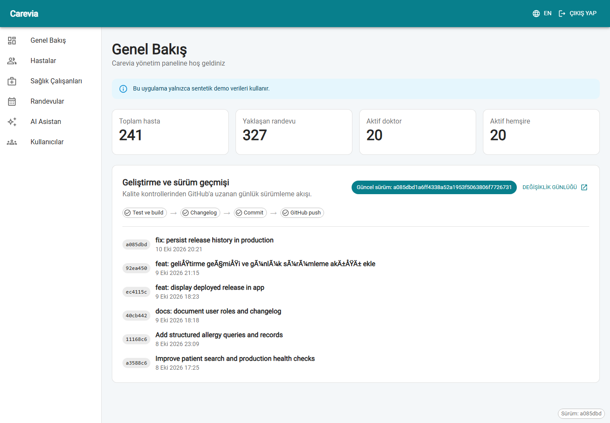
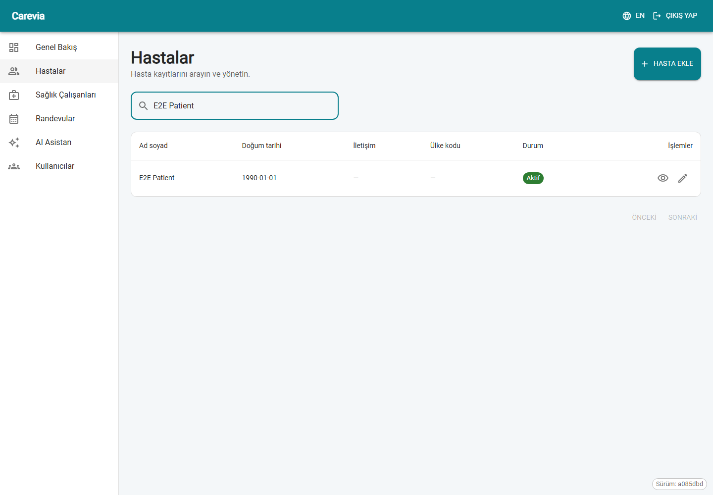
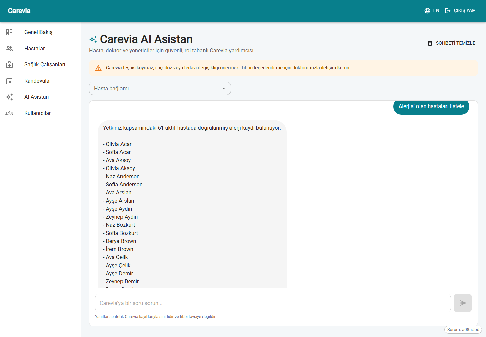

# Carevia

Carevia, React/MUI ve Django REST Framework ile geliştirilen çift dilli bir sağlık yönetimi portföy uygulamasıdır.

Projenin kullanıcıya dönük gelişim geçmişi [`CHANGELOG.md`](CHANGELOG.md) dosyasında tutulur.

> Bu repository kimliği belirlenebilir gerçek hasta verisi içermez. Geliştirme ve demo verileri sentetik olmalıdır.

## Uygulama önizlemesi

### Genel Bakış ve sürüm geçmişi



| Hasta yönetimi | Carevia AI Asistan |
| --- | --- |
|  |  |

Giriş ekranı dahil bütün görseller `npm run capture:screenshots` komutuyla sentetik demo verisi
üzerinden yeniden üretilebilir. Sunum sırası ve konuşma notları için
[`docs/demo-script.md`](docs/demo-script.md) dosyasına bakın.

## Teknoloji seti

- React, TypeScript, Vite
- MUI, React Router, React Hook Form, Zod, TanStack Query
- i18next ve react-i18next
- Django, Django REST Framework, PostgreSQL ve pgvector
- Django session authentication, Groups ve Permissions

## Carevia AI Asistan

Hasta, doktor ve yönetici hesapları `/assistant` ekranındaki rol tabanlı sohbet asistanını kullanabilir.

- Hasta yalnızca kendi profilini, alerji bilgisini ve randevularını sorgulayabilir.
- Doktor, sohbet ekranında seçtiği sentetik hastanın yetkili kayıtlarını sorgulayabilir.
- Doktor ve yönetici, hasta seçmeden "alerjisi olan hastaları listele" veya "kaç hastada
  alerji kaydı var" gibi yetkili toplu sorgular çalıştırabilir.
- Alerjiler; durum, alerjen, reaksiyon ve önem derecesi alanlarıyla yapılandırılmış olarak saklanır.
- Teşhis, ilaç/doz, tedavi değişikliği ve kesin güvence isteyen mesajlar kural tabanlı güvenlik katmanında engellenir.
- Acil durum ifadeleri modelden bağımsız olarak yerel acil yardım kanalına yönlendirilir.
- Sohbet yanıtları kaynak ve güncelleme tarihi gösterebilir; erişimler kullanıcıya bağlı olarak saklanır.

Asistan, `GENAI_API_URL` veya `GENAI_MODEL` boş bırakıldığında harici sohbet modeline veri
göndermeyen deterministik demo modunda çalışır. OpenAI Responses API etkinleştirildiğinde
`GENAI_API_KEY` boşsa embedding anahtarı güvenli biçimde yeniden kullanılır; anahtarlar repository'ye
eklenmez. Yalnızca sentetik veriler kullanın; gerçek sağlık verilerini uygun onay ve korumalar
olmadan üçüncü taraf modele göndermeyin.

Onaylı bir UTF-8 metin dosyasını pgvector bilgi tabanına eklemek için:

```bash
python manage.py ingest_knowledge --source-key carevia-policy --file docs/policy.txt --label "Carevia policy"
```

Küçük sentetik demo bilgi tabanını oluşturmak için `python manage.py seed_knowledge` komutunu
çalıştırın. Aynı içerik yeniden embedding'e dönüştürülmez; yalnızca değişen içerik güncellenir.

## Repository yapısı

```text
frontend/   React uygulaması
backend/    Django API ve yönetim paneli
docs/       Mimari ve ürün kararları
compose.yaml PostgreSQL geliştirme servisi
```

## Yerel geliştirme önkoşulları

- Node.js aktif LTS
- Python 3.12+
- Docker Desktop veya yerel PostgreSQL

## Başlangıç

1. `.env.example` dosyasını `.env` adıyla kopyalayın.
2. PostgreSQL + pgvector'ı başlatın: `docker compose up -d database`
3. Backend için sanal ortam oluşturup `backend/requirements/base.txt` paketlerini yükleyin.
4. `python manage.py migrate` ve `python manage.py createsuperuser` çalıştırın.
5. Frontend klasöründe `npm install` ve `npm run dev` çalıştırın.

Varsayılan sentetik demo veri seti 250 hasta, 20 doktor, 20 hemşire ve 600 randevu
oluşturur:

```bash
python manage.py seed_roles
python manage.py seed_demo --password "yerel-demo-parolasi"
```

Sayılar `--patients`, `--doctors`, `--nurses`, `--secretaries`, `--auditors` ve
`--appointments` seçenekleriyle değiştirilebilir.

## Kullanıcı kategorileri ve rol atama

Carevia kullanıcı yetkilerini Django `Group` kayıtlarıyla yönetir. Uygulamada altı kullanıcı
kategorisi bulunur:

| Kategori | Hasta kayıtları | Randevular | Sağlık çalışanları | AI asistan | Kullanıcı yönetimi |
| --- | --- | --- | --- | --- | --- |
| `Admin` | Tüm kayıtları yönetir | Tümünü yönetir | Görür ve yönetir | Kullanabilir | Görür ve yönetir |
| `Doctor` | Tüm kayıtları yönetir | Tümünü yönetir | Görür | Kullanabilir | Erişemez |
| `Nurse` | Tüm kayıtları yönetir | Tümünü yönetir | Görür | Erişemez | Erişemez |
| `Secretary` | Tüm kayıtları yönetir | Tümünü yönetir | Görür | Erişemez | Erişemez |
| `Patient` | Yalnızca bağlı kendi kaydını görür | Yalnızca kendi randevularını görür | Görür | Kendi verileriyle kullanabilir | Erişemez |
| `Auditor` | Tüm kayıtları salt okunur görür | Tümünü salt okunur görür | Salt okunur görür | Erişemez | Salt okunur görür |

Rol gruplarını ilk kez oluşturmak veya mevcut izinlerle yeniden eşitlemek için backend
klasöründe şu komutu çalıştırın:

```bash
python manage.py seed_roles
```

Kullanıcıya rol vermenin önerilen yolu:

1. `Admin` hesabıyla Carevia'ya giriş yapın.
2. **Kullanıcılar** ekranını (`/users`) açın.
3. **Kullanıcı ekle** seçeneğini seçin.
4. Kullanıcı bilgilerini, en az sekiz karakterli parolayı ve kategoriyi girin.
5. Kullanıcıyı aktif durumda kaydedin.

`Admin` kullanıcıları hesap oluşturabilir, düzenleyebilir, devre dışı bırakabilir ve rolünü
değiştirebilir. `Auditor` kullanıcıları aynı ekranı yalnızca okuyabilir. Uygulama arayüzü her
kullanıcıya tek bir ana kategori atar; backend birden fazla grubu desteklese de yetkilerin
öngörülebilir kalması için normal kullanıcıları tek grupta tutun.

`Patient` kategorisindeki bir hesabın kendi sağlık verilerini görebilmesi için ayrıca bir
`Patient` kaydına bağlanması gerekir. Bu ilişki `Patient.user` alanıdır. Demo verilerinde bağlantı
otomatik kurulur; manuel kullanıcı oluştururken Django admin üzerinden ilgili hasta kaydının
**user** alanını seçin.

Sunum için bütün kategorilerde sentetik kullanıcılar oluşturmanın en hızlı yolu:

```bash
python manage.py seed_roles
python manage.py seed_demo --password "yerel-demo-parolasi"
```

Bu komut gerçek kullanıcı veya hasta verisi yerine yalnızca sentetik demo verileriyle
çalıştırılmalıdır.

## Lightsail geliştirme/test dağıtımı

Üretim benzeri container yapısı `deploy/compose.prod.yaml` dosyasındadır. Backend Gunicorn,
frontend Nginx ile çalışır; PostgreSQL bağlantısı RDS'ye gider. Gerçek
`deploy/.env.production` dosyası git tarafından yok sayılır ve sunucuda `chmod 600` ile
korunmalıdır.

```bash
docker compose -f deploy/compose.prod.yaml build
docker compose -f deploy/compose.prod.yaml run --rm backend python manage.py migrate
docker compose -f deploy/compose.prod.yaml up -d
```

Uygulama trafiğinde RDS master hesabını kullanmayın. Önce en az 32 karakterlik ayrı bir parola
üretip master bağlantısıyla kısıtlı `carevia_app` rolünü oluşturun:

```bash
CAREVIA_RUNTIME_DB_PASSWORD="uzun-ve-rastgele-bir-parola" \
docker compose -f deploy/compose.prod.yaml run --rm backend \
python manage.py configure_runtime_db_user --username carevia_app
```

Ardından `deploy/.env.production` içinde `POSTGRES_USER=carevia_app`, oluşturduğunuz parola ve
`POSTGRES_SSLMODE=require` kullanın. Örnek alanlar `deploy/.env.production.example` dosyasındadır.

Kimliği doğrulanmış API okumaları ve değişiklikleri, istek/yanıt gövdelerini saklamadan
`auditlog_auditevent` tablosuna yazılır. Django admin içindeki **Audit log** ekranı salt okunurdur.

Mevcut Benchmind Caddy proxy'si paylaşılacaksa Carevia frontend servisi
`benchmind_default` ağına `carevia-frontend` takma adıyla katılır. Caddy yönlendirmesi,
Carevia container'ları sağlıklı duruma geldikten sonra eklenmelidir.

## Erişim yaklaşımı

- Doktor, hemşire, sekreter ve yönetici rolleri tüm hasta kayıtlarını görüntüleyebilir.
- Patient grubundaki kullanıcı yalnızca kendi bağlı hasta kaydını görüntüleyebilir.
- Frontend'de menü gizlemek güvenlik kontrolü değildir; erişim kuralları Django API'de uygulanır.

## Kalite kontrolleri

```bash
cd backend
python -m ruff check .
python -m pytest

cd ../frontend
npm run lint
npm run test:run
npm run build
```

Tarayici tabanli Admin ve Patient rol kontrolleri icin once gelistirme veritabaninda
`python manage.py seed_e2e --password "yerel-e2e-parolasi"`, ardindan frontend klasorunde
`CAREVIA_E2E_PASSWORD="yerel-e2e-parolasi" npm run test:e2e` calistirilabilir. Bu komut
`DEBUG=false` ortaminda devre disidir. Dagitim, yedekleme, geri yukleme ve izleme adimlari
[`docs/operations.md`](docs/operations.md) dosyasinda belgelenmistir.

Bu kontroller `.github/workflows/ci.yml` üzerinden her push ve pull request'te de çalışır.

## Gün sonu otomatik sürümleme

Windows'taki **Carevia Daily Commit** görevi her gün saat 21.00'de aşağıdaki akışı çalıştırır:

```text
Değişiklik kontrolü → Gizli dosya kontrolü → Changelog → Test ve build → Commit → GitHub push
```

Görev yalnızca `main` dalı `origin/main` ile eşleşiyorsa ilerler. Merge çakışması, şüpheli dosya,
başarısız test veya build bulunursa commit ve push yapmadan durur. Çalışma kayıtları Git tarafından
yok sayılan `automation/logs/` klasörüne yazılır. Otomasyonun komutları
[`automation/Invoke-DailyCommit.ps1`](automation/Invoke-DailyCommit.ps1), Codex talimatı ise
[`automation/daily-commit-prompt.md`](automation/daily-commit-prompt.md) dosyasındadır.

Genel Bakış ekranındaki **Geliştirme ve sürüm geçmişi** kartı güncel sürümü, son commitleri ve bu
akışı görsel olarak gösterir. Commit kodları ilgili GitHub commit sayfasına bağlanır.

Kararlı sunum sürümleri GitHub'ın **Releases** bölümünde, gün içinde tamamlanan çalışmalar ise
[`CHANGELOG.md`](CHANGELOG.md) ve Genel Bakış ekranında izlenebilir.

